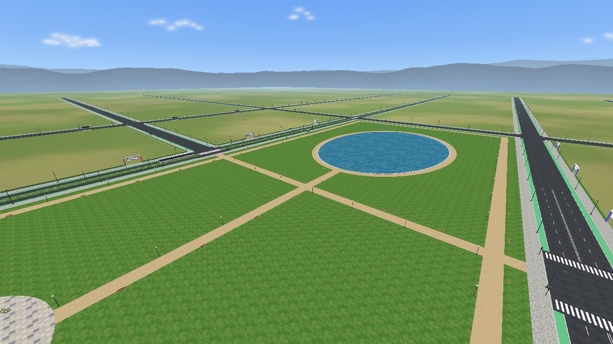
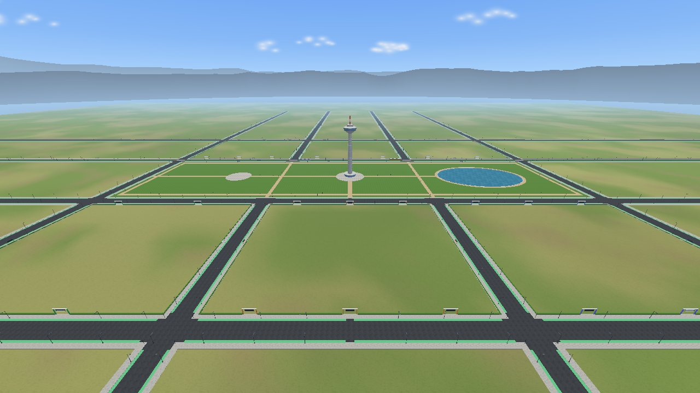

# CityLab

**One city, built together.** CityLab is the course project of *Computer
Graphics* at Amirkabir University of Technology (fall 2026). Every team of
two students picks a topic from a catalogue (an airport, a railway station,
an amusement park, a hospital, a data centre...) and, over three phases,
builds it on the plot that topic owns in a shared modern city. At the end of
the term the whole class walks through the finished city at night, in first
person.



The city itself (the avenues, the trams, the central park with its lake and
tower, the sky, the sun and the shared clock) is already built. Everything
else, from the buildings to the trees, the cars and the boats, is modelled
by the teams. Your team writes one C++ class, a **zone**, that draws your plot with
classic OpenGL. The city places it, lights it, keeps it inside its borders,
and lets visitors walk into it.

| | |
|---|---|
|  |  |

## Contents

1. [What you will build](#what-you-will-build)
2. [Requirements](#requirements)
3. [Quick start](#quick-start)
4. [Setup, method 1: Visual Studio (Windows, recommended)](#setup-method-1-visual-studio-windows-recommended)
5. [Setup, method 2: without Visual Studio (Windows, Linux, macOS)](#setup-method-2-without-visual-studio)
6. [Opening a terminal in the project folder](#opening-a-terminal-in-the-project-folder)
7. [Walking through the city](#walking-through-the-city)
8. [Your team folder](#your-team-folder)
9. [Writing your zone](#writing-your-zone)
10. [The helper commands](#the-helper-commands)
11. [Troubleshooting](#troubleshooting)
12. [Project structure](#project-structure)
13. [Documentation](#documentation)

## What you will build

| Phase | Topic |
|---|---|
| 1 | Modeling with transformations: geometry, translation, rotation, scaling, composition, geometry reuse |
| 2 | Animation: time-based motion, pivots, Bézier motion, easing |
| 3 | Lighting and texture: normals, lighting and materials, textures |

Each phase has its own document, published in [docs/phases](docs/phases)
when the phase starts. Teams and topics are explained in
[docs/project.md](docs/project.md).

The course teaches the fixed-function pipeline, so CityLab uses it too:
`glBegin`/`glEnd`, the matrix stack, `glLight`, `glMaterial`, display lists
and textures. Buffers, vertex-array objects and shaders are not used, and the
lint check rejects them. See [docs/rules.md](docs/rules.md).

## Requirements

You need a computer with Windows 10 or 11 (64-bit), Linux or macOS, any
graphics card or integrated graphics, an internet connection for the
installation, and about 10 GB of free disk space for Visual Studio (about
2 GB without it). Everything below is free.

| Tool | Version | What it is for |
|---|---|---|
| A C++17 compiler | Visual Studio 2022 or 2026 (MSVC), g++ 9+, or Apple clang | compiles the city and your zone |
| CMake | 3.20 or newer | describes the build; it comes with Visual Studio |
| Python | 3.8 or newer | runs `tools/citylab.py`, the helper that builds, runs and checks the city |
| Git | any recent version | downloads the project and sends your work to GitHub |
| A GitHub account | | your team's fork and pull requests ([docs/workflow.md](docs/workflow.md)) |

Choose **one** of the two setup methods. Method 1 is the easiest on Windows.
Method 2 is for Windows without Visual Studio, and for Linux and macOS.

> **A folder without spaces or Persian letters.** Put the project in a short
> path such as `C:\dev\Computer-Graphics-Fall-2026`. Avoid folders under a
> Persian user name and folders synced by OneDrive (Desktop and Documents
> often are): some tools fail there.

## Quick start

If the tools above are installed already, these commands download the
project and start the city. Replace `YOUR-GITHUB-LOGIN` with your GitHub
login (see [Step 4](#step-4-get-the-project) about forking). Type them one
by one; each line is one command.

**Windows** (in PowerShell):

```powershell
New-Item -ItemType Directory -Force -Path C:\dev | Out-Null
cd C:\dev
git clone https://github.com/YOUR-GITHUB-LOGIN/Computer-Graphics-Fall-2026.git
cd C:\dev\Computer-Graphics-Fall-2026
py tools\citylab.py doctor
py tools\citylab.py run
```

**Linux and macOS** (in a terminal):

```bash
mkdir -p ~/dev
cd ~/dev
git clone https://github.com/YOUR-GITHUB-LOGIN/Computer-Graphics-Fall-2026.git
cd ~/dev/Computer-Graphics-Fall-2026
python3 tools/citylab.py doctor
python3 tools/citylab.py run
```

`doctor` checks that the computer is ready. `run` builds the city (a few
minutes the first time) and opens it. If anything is missing, follow one of
the two methods below from the start.

## Setup, method 1: Visual Studio (Windows, recommended)

Visual Studio is Microsoft's development environment. The free **Community**
edition is enough. These steps use Visual Studio 2026; Visual Studio 2022
works the same way. At the end you can run the city in two ways: from a
terminal with `py tools\citylab.py run`, and from Visual Studio itself, where
you also edit and debug your code.

### Step 1. Install Visual Studio with C++

1. Open <https://visualstudio.microsoft.com/downloads/> and press
   **Free download** under **Community**. This downloads a small
   installer (`VisualStudioSetup.exe`). For Visual Studio 2022 use
   <https://visualstudio.microsoft.com/vs/older-downloads/>.
2. Run `VisualStudioSetup.exe`, allow it to make changes, and press
   **Continue**. It installs and opens the **Visual Studio Installer**.
3. On the **Workloads** tab, tick **Desktop development with C++**. This is
   the step that installs the C++ compiler; without it Visual Studio cannot
   build the project.
4. Look at the **Installation details** panel on the right. Under
   *Desktop development with C++* these must be ticked (they are by default):
   - **MSVC ... x64/x86 build tools (Latest)**: the C++ compiler; the exact
     name depends on the version (in Visual Studio 2022:
     *MSVC v143 - VS 2022 C++ x64/x86 build tools (Latest)*)
   - **C++ CMake tools for Windows**
   - **Windows 11 SDK** (or Windows 10 SDK)
5. On the **Language packs** tab, tick **English**. The menu names in this
   README are the English ones.
6. Press **Install** (bottom right) and wait. The download is several
   gigabytes. Restart Windows if the installer asks you to.
7. Start **Visual Studio** from the Start menu. It asks you to sign in; you
   may sign in with a Microsoft account or choose **Skip this for now**. Pick
   a colour theme and press **Start Visual Studio**. Then close it for now.

**Visual Studio is already installed, but without C++?** Add the C++
workload to it:

1. Open the Start menu, type `Visual Studio Installer` and open it (inside
   Visual Studio: **Tools → Get Tools and Features...**).
2. Next to your Visual Studio, press **Modify**.
3. Tick **Desktop development with C++**, check the components listed in
   item 4 above, and press **Modify** (bottom right).
4. When it has finished, close and reopen Visual Studio.

### Step 2. Install Git

1. Download Git for Windows from <https://git-scm.com/downloads/win>
   (**Click here to download**, the 64-bit version).
2. Run it and keep every default option (press **Next** until **Install**).
3. Open a **new** PowerShell window: open the Start menu, type `PowerShell`
   and press Enter. Type this command and press Enter:

   ```powershell
   git --version
   ```

   You should see a version, such as `git version 2.51.0.windows.1`.

4. Tell Git who you are (once per computer), with the e-mail of your GitHub
   account. Two commands, one after the other:

   ```powershell
   git config --global user.name "Your Name"
   git config --global user.email "you@example.com"
   ```

   They print nothing; that is normal.

Instead of the installer you can also type
`winget install --exact --id Git.Git` in PowerShell.

### Step 3. Install Python

Python runs the helper script `tools/citylab.py`, which builds, runs and
checks the city, creates your team folder and packs your work for
submission.

1. Open <https://www.python.org/downloads/windows/> and download the
   **Windows installer (64-bit)** of a recent Python 3 (3.12, 3.13 or 3.14).
2. Run it. On the first screen, tick **Add python.exe to PATH**, then press
   **Install Now**.
3. Close every PowerShell window, open a **new** one and type:

   ```powershell
   py --version
   ```

   You should see a version, such as `Python 3.13.9`. If PowerShell says
   `py` is not recognized, try `python --version`; if that works, write
   `python` instead of `py` in every command of this README.

Instead of the installer you can also type
`winget install --exact --id Python.Python.3.13` in PowerShell.

### Step 4. Get the project

Your team works in its own copy (a **fork**) of the course repository on
GitHub; [docs/workflow.md](docs/workflow.md) explains why.

1. Create a GitHub account at <https://github.com/signup> if you do not have
   one, and sign in.
2. Open the course repository,
   <https://github.com/MajidNami/Computer-Graphics-Fall-2026>, and press
   **Fork** (top right), then **Create fork**. One member of the team forks;
   the other is added as a collaborator (see [docs/workflow.md](docs/workflow.md)).
3. In PowerShell, type these four commands one by one, with your own GitHub
   login in place of `YOUR-GITHUB-LOGIN`:

   ```powershell
   New-Item -ItemType Directory -Force -Path C:\dev | Out-Null
   cd C:\dev
   git clone https://github.com/YOUR-GITHUB-LOGIN/Computer-Graphics-Fall-2026.git
   cd C:\dev\Computer-Graphics-Fall-2026
   ```

   `git clone` prints `Cloning into 'Computer-Graphics-Fall-2026'...` and a
   few progress lines that end with `done.` The project is now in
   `C:\dev\Computer-Graphics-Fall-2026`, and PowerShell is in that folder.

To look around before your team has a fork, clone the course repository
itself: `git clone https://github.com/MajidNami/Computer-Graphics-Fall-2026.git`.

### Step 5. Check the computer

In the same PowerShell window (it must be in the project folder; see
[Opening a terminal in the project folder](#opening-a-terminal-in-the-project-folder)),
type:

```powershell
py tools\citylab.py doctor
```

You should see something like this; every line must say `ok` (or `info`):

```text
CityLab doctor  (Windows 11, AMD64)

  ok    Python 3.13.9
  ok    cmake version 3.31.6-msvc6  (the copy in Visual Studio)
  ok    C++ compiler: Visual Studio Community 2026
  info  not built yet; the first  py tools\citylab.py run  builds it (a few minutes)

ready. Next: py tools\citylab.py run
```

A line that says `fail` names what is missing; [Troubleshooting](#troubleshooting)
says how to fix it.

### Step 6. Run the city from the terminal

In the same window, type:

```powershell
py tools\citylab.py run
```

The first time, it builds the city: it prints the commands it runs and
many lines of compiler output, for two to five minutes. Then the city window
opens at the city gate. Click in it and walk with **W A S D** (see
[Walking through the city](#walking-through-the-city)). To quit, press
**Esc** twice or close the window. The next `run` starts in seconds, because
only what changed is built again.

This command works in any PowerShell window that is in the project folder,
whether Visual Studio is open or not.

### Step 7. Open the project in Visual Studio

Visual Studio is where you write and debug your code.

1. Start Visual Studio and choose **Open a local folder** (or, with Visual
   Studio already open, **File → Open → Folder...**). Choose
   `C:\dev\Computer-Graphics-Fall-2026` and press **Select Folder**.
2. Visual Studio finds `CMakeLists.txt` and `CMakePresets.json` and sets the
   project up by itself. If it asks whether to use `CMakePresets.json`,
   answer **Yes**. Open **View → Output**, choose **CMake** in *Show output
   from*, and wait until it says **CMake generation finished** (about a
   minute the first time).
3. In the toolbar, the configuration box shows **x64 Release** or
   **x64 Debug**. Choose **x64 Release** to walk around (the city runs
   smoothly) and **x64 Debug** only when you need the debugger.
4. **Build → Build All** (or `Ctrl+Shift+B`). The first build takes two to
   five minutes; the Output window ends with **Build All succeeded**.
5. In the toolbar, open the **Select Startup Item** box (next to the green
   ▶ button) and choose **citylab.exe**.
6. **Debug → Start Without Debugging** (or `Ctrl+F5`). The city window opens.
   With **x64 Debug** selected, **Debug → Start Debugging** (`F5`) stops at
   your breakpoints.

Visual Studio also has a terminal: **View → Terminal** opens a PowerShell
that is already in the project folder. Every `py tools\citylab.py ...`
command of this README can be typed there.

Visual Studio builds into the `out\` folder and the helper into `build\`.
The two are separate copies of the same program; both are fine.

### Step 8. Your team's zone

When your team has its topic and number (see [Your team folder](#your-team-folder)),
in a terminal in the project folder (in Visual Studio: **View → Terminal**):

1. Create your folder, with your own team number in place of `team07`:

   ```powershell
   py tools\citylab.py new team07
   ```

   It prints `created teams/team07`. Your code is in
   `teams\team07\src\MyZone.cpp`.
2. Run the city with only your zone, starting at your plot:

   ```powershell
   py tools\citylab.py run team07
   ```

3. To do the same from Visual Studio: **Build → Build All** (the build finds
   the new folder by itself). Then, with **citylab.exe** selected as the
   startup item, choose **Debug → Debug and Launch Settings for citylab**.
   Visual Studio opens `launch.vs.json`; add the `args` line as below, save
   it (`Ctrl+S`) and press `Ctrl+F5`:

   ```json
   {
     "version": "0.2.1",
     "defaults": {},
     "configurations": [
       {
         "type": "default",
         "project": "CMakeLists.txt",
         "projectTarget": "citylab.exe",
         "name": "citylab.exe",
         "args": [ "--team", "team07" ]
       }
     ]
   }
   ```

   Other [options](#useful-options), such as `"--time", "20:30"`, go in the
   same list.
4. Before you push or submit, run the graders' check:

   ```powershell
   py tools\citylab.py check team07
   ```

   It runs your zone, prints one line per check (`PASS`, `WARN` or `FAIL`)
   and saves a report and four screenshots in `build\check\`.

The Visual Studio setup is complete. Continue with
[Walking through the city](#walking-through-the-city).

## Setup, method 2: without Visual Studio

Here the city is built from a terminal by `tools/citylab.py`, which runs
CMake and the compiler for you. Write your code in any editor, for example
[Visual Studio Code](https://code.visualstudio.com/).

### Windows: MinGW-w64 through MSYS2

1. **Git and Python.** Install them as in [Step 2](#step-2-install-git)
   and [Step 3](#step-3-install-python) of method 1.
2. **MSYS2.** Download the installer from <https://www.msys2.org/>
   (`msys2-x86_64-....exe`), run it and keep the folder `C:\msys64`.
3. **The compiler, CMake and make.** Open **MSYS2 UCRT64** from the Start menu
   (not *MSYS2 MSYS* or *MSYS2 MINGW64*). In that window, update MSYS2:

   ```bash
   pacman -Syu
   ```

   Answer `Y` and press Enter. If the window closes by itself, open
   **MSYS2 UCRT64** again and run `pacman -Syu` once more. Then install the
   tools (answer `Y` again):

   ```bash
   pacman -S --needed mingw-w64-ucrt-x86_64-gcc mingw-w64-ucrt-x86_64-cmake mingw-w64-ucrt-x86_64-make
   ```

   Close the MSYS2 window; the rest happens in PowerShell.
4. **Put them on the PATH**, so PowerShell finds them. Open PowerShell and
   type (one long line):

   ```powershell
   [Environment]::SetEnvironmentVariable("Path", [Environment]::GetEnvironmentVariable("Path", "User") + ";C:\msys64\ucrt64\bin", "User")
   ```

   It prints nothing. (By hand instead: Start menu → *Edit environment
   variables for your account* → **Path** → **Edit** → **New** →
   `C:\msys64\ucrt64\bin` → **OK**.)
5. Close every PowerShell window, open a new one and check, one command at a
   time:

   ```powershell
   g++ --version
   cmake --version
   mingw32-make --version
   ```

   Each prints a version: g++ must be 9 or newer, CMake 3.20 or newer.
6. **Get the project** as in [Step 4](#step-4-get-the-project) (fork, then the
   four commands).
7. **Check and run**, in the same window:

   ```powershell
   py tools\citylab.py doctor
   py tools\citylab.py run
   ```

   `doctor` must say `ok` on every line (the last may say `info`); the
   compiler line names g++ and *MinGW Makefiles*. `run` builds the city (a
   few minutes the first time) and opens it.

If Visual Studio is installed as well, `tools/citylab.py` uses Visual Studio
instead. To change compilers later, delete the `build` folder first.

### Linux (Ubuntu, Debian, Linux Mint)

1. Open a terminal (`Ctrl+Alt+T`) and install the compiler, CMake, Git,
   Python and the OpenGL and X11 headers (two commands; type your password
   when asked):

   ```bash
   sudo apt update
   sudo apt install -y build-essential cmake git python3 libgl1-mesa-dev libx11-dev
   ```

   On Fedora: `sudo dnf install -y gcc-c++ make cmake git python3 mesa-libGL-devel libX11-devel`.
   On Arch: `sudo pacman -S --needed base-devel cmake git python mesa libx11`.

2. Tell Git who you are:

   ```bash
   git config --global user.name "Your Name"
   git config --global user.email "you@example.com"
   ```

3. Fork the course repository (as in [Step 4](#step-4-get-the-project)),
   then clone your fork:

   ```bash
   mkdir -p ~/dev
   cd ~/dev
   git clone https://github.com/YOUR-GITHUB-LOGIN/Computer-Graphics-Fall-2026.git
   cd ~/dev/Computer-Graphics-Fall-2026
   ```

4. Check and run:

   ```bash
   python3 tools/citylab.py doctor
   python3 tools/citylab.py run
   ```

The window opens on X11 and on Wayland (through XWayland).

### macOS

1. Install Apple's command-line tools (compiler and Git). Open **Terminal**
   (Spotlight: `Cmd+Space`, type `Terminal`) and type:

   ```bash
   xcode-select --install
   ```

   A dialog opens; press **Install**.
2. Install Homebrew from <https://brew.sh>, then CMake and Python:

   ```bash
   /bin/bash -c "$(curl -fsSL https://raw.githubusercontent.com/Homebrew/install/HEAD/install.sh)"
   brew install cmake python
   ```

   At the end, the Homebrew installer prints two or three commands under
   *Next steps*; run them so that `brew` is on your PATH, then run
   `brew install cmake python`.
3. Tell Git who you are, get the project, check and run, exactly as in steps
   2 to 4 for Linux.

macOS marks classic OpenGL as deprecated but still runs it, on Intel and on
Apple silicon.

## Opening a terminal in the project folder

Every `tools/citylab.py` command runs in a terminal **in the project
folder**, the one that holds `README.md`, `CMakeLists.txt` and `tools`.

**Windows**, any of these:

- In Visual Studio, with the project open: **View → Terminal**.
- In File Explorer, open `C:\dev\Computer-Graphics-Fall-2026`, click in the
  address bar at the top, type `powershell` and press Enter.
- Open PowerShell from the Start menu and type
  `cd C:\dev\Computer-Graphics-Fall-2026`.

**Linux and macOS:** open a terminal and type `cd ~/dev/Computer-Graphics-Fall-2026`.

To check that you are in the right place, type `dir` (Windows) or `ls`
(Linux, macOS): the list must show `README.md`, `CMakeLists.txt` and `tools`.

## Walking through the city

When `run` has built the city, a window opens at the city gate. Click in the
window to look around with the mouse, walk with **W A S D** or the arrow
keys, and press **F1** for every key. **Esc** gives the mouse back; a second
**Esc** quits.

| Key | |
|---|---|
| W A S D, arrows | walk (hold **Shift** to run, **Ctrl** to creep) |
| click, then move the mouse | look around; **Esc** frees the mouse (dragging works too) |
| click on the map | jump there |
| mouse wheel | walking and flying speed: faster or slower by a tenth per notch (zoom when orbiting) |
| F9 | walk → fly → orbit |
| F11 | walk through walls and buildings, or be stopped by them |
| Q / E | down / up when flying; zoom when orbiting |
| Tab, Shift+Tab | jump to the next or previous place |
| Home | back to the city gate |
| F4 | map |
| F5, F6, F7 | clock speed, pause the clock, one hour later |
| F8 | restart the zone you are standing at |
| F2, F3 | plot borders, statistics (frames per second, how much the city draws, the time of each zone) |
| F10, F12 | hide the display, save a screenshot in `screenshots/` |

Every other letter, digit and Space goes to the zone you are standing at, so
your zone can react to keys of its own.

The walking view shows two hands in full-finger leather gloves, with padded
knuckles and jacket sleeves. They sway as you move and look around.
Fly and orbit modes keep an unobstructed view of the city.

[Preview of the gloved walking view](docs/images/first-person-gloves.png).

### Settings

The first run writes `settings.json` in the project folder. Change it to suit
you, for example a slower mouse or a wider view; it is yours and is not
committed:

```json
{
  "mouse_sensitivity": 1,
  "invert_mouse": false,
  "field_of_view": 75,
  "walk_speed": 7,
  "run_speed": 16,
  "fly_speed": 30,
  "head_bob": true,
  "vsync": true,
  "msaa": 4,
  "walk_through_objects": false
}
```

- `walk_speed`, `run_speed` and `fly_speed` (metres per second) are the speeds
  the program starts with; the mouse wheel changes them while you walk or fly.
- `walk_through_objects` is what **F11** switches.
- `msaa` is the smoothing of edges (0, 2, 4 or 8). On a slow graphics card, 2
  or 0 makes the city lighter.
- `vsync` waits for the screen to refresh before showing a frame: no tearing,
  and the movement stays even. Leave it on. Turn it off (`false`, or
  `--no-vsync` for one run) to see in the **F3** statistics how fast your
  computer and your zone really are.

### Useful options

Options for the program follow `run` (and your team, if you name it):

```powershell
py tools\citylab.py run team07 --time 20:30
```

(Linux and macOS: `python3 tools/citylab.py run team07 --time 20:30`.) In
Visual Studio they go in `"args"` in `launch.vs.json` (see
[Step 8](#step-8-your-teams-zone)).

| Option | |
|---|---|
| `--time 20:30` | start the clock in the evening (test your lights) |
| `--time-scale 0` | stop the clock |
| `--fixed-dt 0.1` | advance exactly 0.1 s per frame (test time-based motion) |
| `--fly`, `--orbit` | start in another camera mode |
| `--tour` | walk through every street automatically |
| `--team team07,team08` | run several zones |
| `--no-zones` | the city without any team |
| `--no-vsync` | do not wait for the screen (see `vsync` above) |
| `--msaa 0` | no edge smoothing, for one run |

## Your team folder

The staff publish the catalogue of topics ([docs/city.md](docs/city.md)).
When your team has its topic, it is listed in `city/registry.json` with your
GitHub logins, and the topic decides your plot. In a terminal in the project
folder, create your folder from the template and run it:

| | Windows | Linux and macOS |
|---|---|---|
| create the folder | `py tools\citylab.py new team07` | `python3 tools/citylab.py new team07` |
| run your zone at your plot | `py tools\citylab.py run team07` | `python3 tools/citylab.py run team07` |
| list every plot and topic | `py tools\citylab.py plots` | `python3 tools/citylab.py plots` |

The template draws a small house with a lawn and a weather vane that turns
when you press **V**. Replace it with your own project.

You can start before the staff have added your team to `city/registry.json`.
Until then your zone runs on a free plot (the terminal says which one), and
`check` gives two warnings that are expected: `registered` (not in the
registry yet) and `names on the sign` (the titles are empty). Both go away
once your team is registered and `team.json` is filled in.

Then fill in `teams/team07/team.json`. If your team was registered when you
ran `new`, the titles are already your topic's; otherwise write them yourself
(the Persian and English names of every topic are in `city/places.json`).
Change them if your place has a name of its own:

```json
{
  "id": "team07",
  "title": "ایستگاه راه‌آهن",
  "title_en": "Railway Station",
  "members": [
    {"name": "Sara Ahmadi", "student_id": "40131001", "github": "sara-a"},
    {"name": "Ali Karimi", "student_id": "40131002", "github": "alikarimi"}
  ]
}
```

`title` (Persian) and `title_en` go on the sign at your plot's gate.

Your folder looks like this; you change nothing outside it:

```text
teams/team07/
├── team.json        your team, its members and the names on the sign
├── README.md        your report for each phase
├── assets/          textures and data files (PNG, JPG, BMP, TGA)
└── src/
    └── MyZone.cpp   your zone; add more .cpp and .h files as it grows
```

New `.cpp` files in `src/` are found by the next build, in Visual Studio too.

## Writing your zone

A zone is one class that derives from `citylab::Zone`. The city calls its
methods; you never call them yourself.

```cpp
#include <citylab/CityLab.h>

namespace team07 {
using namespace citylab;

class HangarZone : public Zone {
public:
    void init(Context& ctx) override {        // once: textures, display lists, colliders
        hangar_ = glGenLists(1);
        glNewList(hangar_, GL_COMPILE);
        shapes::box(30.0f, 12.0f, 20.0f);
        glEndList();
    }
    void update(const Frame& frame) override {  // every frame: move things with frame.dt
        angle_ += 30.0f * frame.dt;
    }
    void draw(const Context& ctx) const override {  // every frame: draw in plot-local metres
        glPushMatrix();
        glTranslatef(0.0f, 6.0f, -20.0f);
        glCallList(hangar_);
        glTranslatef(0.0f, 6.5f, 0.0f);       // a radar on the roof that turns
        glRotatef(angle_, 0.0f, 1.0f, 0.0f);
        shapes::box(4.0f, 0.4f, 0.4f);
        glPopMatrix();
    }
    void reset() override { angle_ = 0.0f; }    // F8
    void onKey(int key) override {}             // keys pressed at your plot

private:
    GLuint hangar_ = 0;
    float angle_ = 0.0f;
};
}  // namespace team07

CITYLAB_REGISTER_ZONE(team07::HangarZone);
```

| | What it gives you | Header |
|---|---|---|
| `Frame` | `dt`, `time`, `timeOfDay`, `daylight`, `sunDirection`, `cameraPosition` | `Zone.h` |
| `Context` | `plot()` (its size), `loadTexture()`, `createTexture()`, `addCollider()`, `log()` | `Context.h` |
| `shapes::` | box, plane, disk, cylinder, cone, sphere, torus, gable roof, with normals and UVs | `Shapes.h` |
| `props::` | the city's benches, flower beds, street and park lamps, bus shelter and crane, and a shrub | `Props.h` |

There are no trees and no cars in the SDK: model your own. The headers are
in `sdk/cpp/citylab/` and every function in them is explained there.
Coordinates are plot-local metres: x from −40 to +40 across the frontage
(−80 to +80 on a double plot), z from −50 at the back to +50 at the gate on
the street, y from 0 up to 40 (and down to −5). Always read the size from
`ctx.plot()`. [docs/rules.md](docs/rules.md) is the contract: what the city
sets up before `draw()`, what belongs to the city, and the budgets.

## The helper commands

Type them in a terminal in the project folder. Every command prints what it
runs.

| What | Windows | Linux and macOS |
|---|---|---|
| is this computer ready? | `py tools\citylab.py doctor` | `python3 tools/citylab.py doctor` |
| build and open the city | `py tools\citylab.py run` | `python3 tools/citylab.py run` |
| build and open, only your zone, at your plot | `py tools\citylab.py run team07` | `python3 tools/citylab.py run team07` |
| only build | `py tools\citylab.py build` | `python3 tools/citylab.py build` |
| create your team folder | `py tools\citylab.py new team07` | `python3 tools/citylab.py new team07` |
| the graders' check: report and four screenshots in `build/check/` | `py tools\citylab.py check team07` | `python3 tools/citylab.py check team07` |
| the project rules in the code (classic OpenGL only, file types, size) | `py tools\citylab.py lint team07` | `python3 tools/citylab.py lint team07` |
| the zip to upload to Courses, in `dist/` | `py tools\citylab.py pack team07 --phase 1` | `python3 tools/citylab.py pack team07 --phase 1` |
| every plot, its size, topic and team | `py tools\citylab.py plots` | `python3 tools/citylab.py plots` |
| help | `py tools\citylab.py --help` | `python3 tools/citylab.py --help` |

## Troubleshooting

| What you see | What to do |
|---|---|
| `'py' is not recognized` (or `python3: command not found`) | Python is not installed, or the terminal was opened before it was. Install it ([Step 3](#step-3-install-python)) and open a new terminal. |
| `'git' is not recognized` | Install Git ([Step 2](#step-2-install-git)) and open a new terminal. |
| `can't open file '...tools\citylab.py': No such file or directory` | The terminal is not in the project folder. See [Opening a terminal in the project folder](#opening-a-terminal-in-the-project-folder). |
| `fatal: repository not found` when cloning | Check the address: your own GitHub login, and that the fork exists (open it in the browser). |
| `fatal: destination path ... already exists` | The project was cloned before. Just `cd` into it. |
| `doctor`: `fail  CMake 3.20 or newer is needed` | Visual Studio: open the **Visual Studio Installer** → **Modify** → tick **C++ CMake tools for Windows** → **Modify**. MSYS2: check step 3 and 4 of [the MSYS2 setup](#windows-mingw-w64-through-msys2). Linux: `sudo apt install cmake`. macOS: `brew install cmake`. |
| `doctor`: `fail  no usable C++ compiler` | The C++ workload is missing: open the **Visual Studio Installer** → **Modify** → tick **Desktop development with C++** ([Step 1](#step-1-install-visual-studio-with-c)). |
| `doctor` says g++ is too old | An old MinGW (often installed with Code::Blocks or Dev-C++) comes first on the PATH. Remove it from the PATH or install a new compiler as above, then delete the `build` folder. |
| Visual Studio has no **CMake** in *Show output from*, or cannot find a compiler | The same as the two lines above: add **Desktop development with C++** with **C++ CMake tools for Windows**. |
| The build fails after you changed compilers or moved the folder | Delete the `build` folder (and `out` for Visual Studio) and build again. In Visual Studio: **Project → Delete Cache and Reconfigure**. |
| The build fails in another team's folder | `citylab.py build` leaves that team out and builds the rest; tell the staff. |
| Your plot is empty and the panel at the top left says *stopped* | Your zone stopped with an error; the panel and the terminal say where. Fix it, build again and press **F8** at your plot. |
| The window opens but is black or very slow | Update your graphics driver. On a laptop with two graphics cards, choose the faster one for `citylab.exe` in Windows *Settings → System → Display → Graphics*. Set `"msaa": 0` in `settings.json`. |
| Nothing else helps | Open an [Issue](../../issues/new/choose) with the output of `doctor` and the first error. |

## Project structure

```text
Computer-Graphics-Fall-2026/
├── CMakeLists.txt          the build: the city, the SDK and every team folder
├── CMakePresets.json       Visual Studio configurations (x64 Release, x64 Debug)
├── cmake/                  CMakeLists helpers (finding the team folders)
├── core/                   the city program (staff code)
│   ├── app/                the program, the HUD, the automatic check
│   ├── city/               the plan, streets, park, tower, trams
│   ├── engine/             camera, clock, sky, textures, settings
│   ├── framework/          the window on Windows, Linux and macOS
│   ├── zones/              runs each team's zone inside its plot
│   └── external/           third-party code: GLM, stb_image
├── sdk/cpp/citylab/        the SDK your zone uses: Zone.h, Context.h, Shapes.h, Props.h
├── city/                   the plan, the catalogue of topics, the team registry, the signs
├── teams/
│   ├── _templates/         what `citylab.py new` copies
│   └── teamNN/             one folder per team; yours is the only one you change
├── tools/
│   ├── citylab.py          doctor, build, run, new, check, lint, pack, plots
│   └── staff/              tools the staff use to generate the plan and the signs
├── docs/                   the project, the phases, the rules, the city, the GitHub workflow
└── .github/                issue and pull request templates, automatic checks (CI)
```

Files you create while working stay out of Git (`.gitignore`): `build/`,
`out/`, `dist/`, `screenshots/` and `settings.json`.

## Documentation

| Read | When |
|---|---|
| [The project](docs/project.md) | Teams and topics |
| [The phases](docs/phases) | The document of each phase, published when the phase starts |
| [Rules of the city](docs/rules.md) | The plot contract, budgets and what the city checks |
| [The city](docs/city.md) | The plan, the six districts and the catalogue of topics |
| [Working with GitHub](docs/workflow.md) | Fork, pull request, staying up to date, submitting a phase |

Open an [Issue](../../issues/new/choose) for a bug in the city or a missing
feature, or to propose a new topic. Questions about the course go to the
course channel.

---

CityLab is built by the course staff. Third-party code: GLM (MIT,
`core/external/glm`), stb_image (public domain or MIT, `core/external/stb`)
and the Vazirmatn font (SIL OFL, `tools/staff/fonts`).
