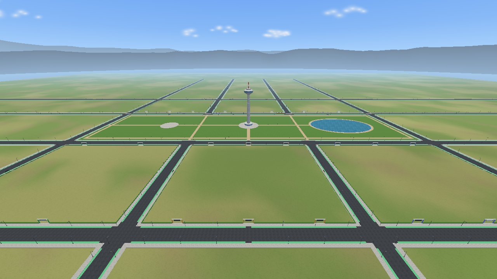

# The city

CityLab is a modern grid city of about 840 × 720 m. Six districts of six
plots stand around a central park, and every topic in the catalogue has its
own plot in the district that suits it. Every number on this page comes from
`city/layout.json`, which the staff generate from `city/places.json`.
`python3 tools/citylab.py plots` (on Windows `py tools\citylab.py plots`) prints
the same list with the teams.



## The plan

```
                                   north (-z)
          +-------------------------------------------------------------------------------+
          |=========================== north avenue ===================================|
   west   |  Culture & Education  ‖  Business & Shopping  ‖  Sports & Leisure          |  east
  avenue  |   CU-1  CU-2  CU-3    ‖   CO-1  CO-2  CO-3    ‖   SP-1 + SP-2   SP-3       | avenue
          |   CU-4  CU-5  CU-6    ‖   CO-4  CO-5  CO-6    ‖   SP-4 + SP-5   SP-6       |
          |=========================== park avenue ====================================|
          |     lake                 central park and tower                fountain    |
          |=========================== tram boulevard =================================|
          |   TR-1 + TR-2   TR-3    ‖   SV-1  SV-2  SV-3    ‖   EN-1  EN-2  EN-3       |
          |   TR-4 + TR-5   TR-6    ‖   SV-4  SV-5  SV-6    ‖   EN-4  EN-5  EN-6       |
          |  Transport              ‖  City Services        ‖  Energy & Industry         |
          |=========================== south avenue ===================================|
          +-------------------------------------------------------------------------------+
                                   south (+z)
```

- **Coordinates.** Metres, +x east, +y up, −z north. The tower in the park is
  at (0, −40) and is 120 m high, so it shows the way from every street.
- **The entrance.** You start on the north avenue at (0, −385), looking south
  into the city.
- **Streets.** Four avenues run round the city, a park avenue and the tram
  boulevard cross it, and an inner avenue (‖) runs between the blocks. There
  are no dead ends.
- **Blocks.** Each block is two back-to-back rows of three plots. A plot's
  gate opens on the street in front of its row: the first row of each block
  faces north, the second faces south.
- **Plots** are 80 × 100 m, roomy on purpose: what a project does not fill with
  its own buildings becomes its grounds, with trees, paths and seating that
  the team models itself. Plots in a row touch, so two neighbours make one
  160 × 100 m plot. The stadium, the amusement park, the railway station and
  the airport have double plots from the start.

## Districts and topics

Every topic is a whole project for a team of two. `city/places.json` also
suggests what each phase could add to each topic, in English and Persian;
the ideas are starting points, not requirements.

### Culture & Education (CU)

| Plot | Size | Topic | Gate on |
|---|---|---|---|
| CU-1 | 80 × 100 | Observatory & Planetarium (`observatory`) | north avenue |
| CU-2 | 80 × 100 | Science Museum (`science-museum`) | north avenue |
| CU-3 | 80 × 100 | Public Library (`library`) | north avenue |
| CU-4 | 80 × 100 | Cinema Multiplex (`cinema`) | park avenue |
| CU-5 | 80 × 100 | Concert Hall (`concert-hall`) | park avenue |
| CU-6 | 80 × 100 | Art Gallery (`art-gallery`) | park avenue |

### Business & Shopping (CO)

| Plot | Size | Topic | Gate on |
|---|---|---|---|
| CO-1 | 80 × 100 | Office Tower (`office-tower`) | north avenue |
| CO-2 | 80 × 100 | Shopping Mall (`shopping-mall`) | north avenue |
| CO-3 | 80 × 100 | Hotel (`hotel`) | north avenue |
| CO-4 | 80 × 100 | Café Street (`cafe-street`) | park avenue |
| CO-5 | 80 × 100 | Car Showroom (`car-showroom`) | park avenue |
| CO-6 | 80 × 100 | free | park avenue |

### Sports & Leisure (SP)

| Plot | Size | Topic | Gate on |
|---|---|---|---|
| SP-1 + SP-2 | 160 × 100 | Football Stadium (`stadium`) | north avenue |
| SP-3 | 80 × 100 | free | north avenue |
| SP-4 + SP-5 | 160 × 100 | Amusement Park (`amusement-park`) | park avenue |
| SP-6 | 80 × 100 | Swimming Pool (`swimming-pool`) | park avenue |

### Transport (TR)

| Plot | Size | Topic | Gate on |
|---|---|---|---|
| TR-1 + TR-2 | 160 × 100 | Railway Station (`railway-station`) | tram boulevard |
| TR-3 | 80 × 100 | Cable Car Station (`cable-car`) | tram boulevard |
| TR-4 + TR-5 | 160 × 100 | Airport (`airport`) | south avenue, at the edge of the city |
| TR-6 | 80 × 100 | Bus Terminal (`bus-terminal`) | south avenue |

### City Services (SV)

| Plot | Size | Topic | Gate on |
|---|---|---|---|
| SV-1 | 80 × 100 | Hospital (`hospital`) | tram boulevard |
| SV-2 | 80 × 100 | Fire Station (`fire-station`) | tram boulevard |
| SV-3 | 80 × 100 | City Hall & Clock Tower (`city-hall`) | tram boulevard |
| SV-4 | 80 × 100 | Fuel and EV Station (`fuel-station`) | south avenue |
| SV-5 | 80 × 100 | Logistics Hub (`logistics-hub`) | south avenue |
| SV-6 | 80 × 100 | Weather Station (`weather-station`) | south avenue |

### Energy & Industry (EN)

| Plot | Size | Topic | Gate on |
|---|---|---|---|
| EN-1 | 80 × 100 | Solar Power Plant (`solar-plant`) | tram boulevard |
| EN-2 | 80 × 100 | Wind Farm (`wind-farm`) | tram boulevard |
| EN-3 | 80 × 100 | Water Treatment Plant (`water-treatment`) | tram boulevard |
| EN-4 | 80 × 100 | Car Factory (`car-factory`) | south avenue |
| EN-5 | 80 × 100 | Recycling Plant (`recycling-plant`) | south avenue |
| EN-6 | 80 × 100 | Container Terminal (`container-terminal`) | south avenue |

### What each topic offers for phase 2

Phase 2 asks for three moving elements that show three different ideas
([the project](project.md#phase-2-bring-it-to-life)): a rotation about an
off-centre pivot, a motion along a Bézier path, and a moving hierarchy. Every
topic offers an idea for each of the three, so no team is left without a way
to show one of them. These are suggestions (the full list of ideas for each
phase is in `city/places.json`); your own idea is as good, if it shows the
same thing. The requirements are the same for every topic: a topic with many
ideas (the airport) does not need all of them, and a topic with fewer has
room to do each one well.

| Plot | Topic | Rotation about an off-centre pivot | Motion along a Bézier path | Moving hierarchy (two or more moving levels) |
|---|---|---|---|---|
| CU-1 | Observatory & Planetarium | Dome shutter hinged at its edge | A shooting star at night | Telescope: mount, then tube (two joints) |
| CU-2 | Science Museum | Foucault pendulum | Rocket lift-off | Planets: sun, planet, moon |
| CU-3 | Public Library | Automatic door | Book carts between the shelves | Return robot arm with two joints |
| CU-4 | Cinema Multiplex | Ticket barrier arm | A limousine arriving for the premiere | Searchlight on a two-joint mount |
| CU-5 | Concert Hall | Piano lid on its hinge | A follow spot gliding over the stage | Lighting rig: truss, then spot arms |
| CU-6 | Art Gallery | Revolving gallery door | A guide drone along the visitors' route | Hanging mobile with several levels |
| CO-1 | Office Tower | Lobby door on a hinge | A delivery drone to the roof | Window cradle: boom, then cradle |
| CO-2 | Shopping Mall | Car-deck door on a hinge | Shoppers walking on paths | Kinetic sculpture in the atrium |
| CO-3 | Hotel | Taxi door or umbrella ribs | The taxi arriving | Rooftop restaurant: disc, then tray |
| CO-4 | Café Street | Umbrellas opening | The waiter on a path | Coffee-cup sign: arm, then cup |
| CO-5 | Car Showroom | Car doors and bonnet | The car driving out | Turntable, car, wheels |
| SP-1 | Football Stadium | Turnstile arms | The ball | Player: torso, arm, forearm |
| SP-4 | Amusement Park | Ride gate | Roller coaster | Ferris wheel: wheel, then cabins |
| SP-6 | Swimming Pool | Diving board | Slides with swimmers | Pool hoist: arm, then seat |
| TR-1 | Railway Station | Level-crossing barrier | The train | Car, bogie, wheel |
| TR-3 | Cable Car Station | Cabin doors hinged at one edge | Cabins along the cable, easing in the stations | Cabin on its hanger arm, swinging under the grip |
| TR-4 | Airport | Cargo door | The plane landing | Boarding bridge: two telescoping parts and the cabin |
| TR-6 | Bus Terminal | Bus doors, exit barrier | The bus into its bay | Articulated bus: front, joint, rear |
| SV-1 | Hospital | Ambulance-bay barrier | Ambulance and helicopter approach | Helicopter: body, rotor, blades |
| SV-2 | Fire Station | Bay door | The engine driving out | Ladder: turntable, ladder, extension |
| SV-3 | City Hall & Clock Tower | Clock hands about their hubs, driven by the city clock | Figures parading along a curve at noon | Bell: frame, then bell, then clapper |
| SV-4 | Fuel and EV Station | Car-wash barrier | The car through the wash | Brush arm: gantry, arm, brush |
| SV-5 | Logistics Hub | Dock levellers | Delivery drones | Forklift: truck, mast, forks |
| SV-6 | Weather Station | Wind vane turning about the mast | A weather balloon rising along a curve | Dish: turntable, then tilt, then feed arm |
| EN-1 | Solar Power Plant | Panels tilting to the sun | The cleaning robot | Robot: base, arm, brush |
| EN-2 | Wind Farm | Nacelle turning into the wind | A service vehicle on the visitor path | Tower, nacelle, rotor, blades |
| EN-3 | Water Treatment Plant | Sluice gate | An inspection boat circling the basin | Rotating bridge: bridge, then scraper |
| EN-4 | Car Factory | Car doors on the line | The car on the test track | Robot arm with three joints |
| EN-5 | Recycling Plant | Tipping truck bed | A truck arriving | Crane: boom, cable, grabber |
| EN-6 | Container Terminal | Ship ramp | The ship docking | Gantry crane: gantry, trolley, spreader |

## Room to grow

Two plots (CO-6 and SP-3) are free, and so is the plot of every topic no
team picks. A team that needs more room can be given the free plot next to
it in the same row. Your code does not change: `plot().width` becomes 160
and the borders follow it. A new topic can be proposed with an Issue.

## What you see on a plot

| The plot | What the city draws |
|---|---|
| No team yet | a meadow staked out every 10 m, and the topic on the sign ("coming soon") |
| A team, but its zone is not running | a building site: soil, site cabins and a turning crane |
| A running zone | only what the zone draws: the city lays no ground under it |

The sign over each gate shows the plot, the topic and the team. Its names
come from `title` and `title_en` in your `team.json`.

## Life in the city

The city is not still while you build. None of this enters your plot, and
your zone does not need to know about it.

- **Trams.** Trams run both ways along the tram boulevard, keep to the right,
  stop at the traffic lights at every crossing and at five shelters along the
  park, and wait for a walker on the track.
- **The park.** Lawns and paths, benches and lamps, a lake, a fountain, and
  the tower, lit in colour at night.
- **The streets.** Traffic lights at every crossing and a lamp every 36 m
  along the sidewalks, with room kept clear at every gate, crossing and tram
  stop.
- **Around the city.** Open fields, and hills in the distance.

The city has no trees, cars, boats or buildings of its own (apart from the
tower): those are for the teams to model. It is light enough for an ordinary laptop, because it draws only what
you can see (what is behind you or beyond the fog is left out). None of this
concerns your plot.

## The clock and the light

- The shared clock starts at 10:00. A day takes about 18 real minutes and a
  night about 4 (47 city seconds per real second by day, 3.5 times faster
  at night). **F5** changes the speed, **F6** pauses, **F7** jumps an hour,
  and `--time 20:30` starts at any time.
- The sun is `GL_LIGHT0`. It follows the clock, and its colour changes at
  dawn and dusk. A soft sky light (`GL_LIGHT7`) keeps shadows from going
  black.
- At night the streets are lit by the city's lamps; your plot is lit only
  by your own lights (`GL_LIGHT1` to `GL_LIGHT4`). The final presentation is
  at night, so make the night worth seeing.
- Fog fades the far end of the city into the sky. Your plot gets the same
  fog, so it fits in without any work.

## The city's props in your plot

The flower beds, benches, street and park lamps, bus shelters and cranes that
the city uses, and a simple shrub, are in the SDK (`props::bench()`,
`props::streetLamp()`, ...). Use them for the surroundings of your plot. They
are not graded: the phases ask for objects you model yourselves. Trees and
cars are not in the SDK; model your own. Every prop is described in
`sdk/cpp/citylab/Props.h`.
